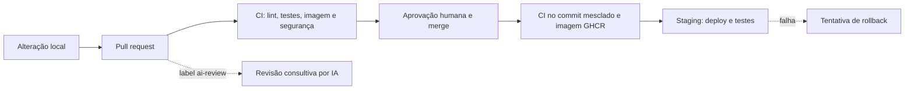

# AI Dev Pipeline

Projeto de portfólio que demonstra uma API de tarefas, verificações automatizadas, revisão consultiva por IA e entrega em um único ambiente de staging. O serviço é uma **demonstração**, não um sistema de produção real. O repositório não apresenta métricas de impacto não medidas.



## Etapas

| Etapa | Verificação ou ação | Bloqueio |
| --- | --- | --- |
| Local | Hook opcional: espaços, lint e tipos | Local |
| PR | CI: lint, tipos, auditoria, testes, imagem e Trivy | Configurar como obrigatório |
| Preview por PR | Serviço Render e branch Neon isolados, SHA e E2E | Status `preview-render`, após validação e configuração |
| Segurança | CodeQL e Gitleaks em PR e semanalmente | Configurável no GitHub |
| IA | Revisão e lacunas de testes, ativadas pelo label | Consultivo |
| Merge | Revisão humana e CODEOWNERS | Configurar na proteção |
| Pós-merge | CI novamente e publicação no GHCR | Falhas impedem staging |
| Staging | Deploy por commit, E2E e smoke | Falhas marcam a entrega como malsucedida |
| Contínuo | Dependabot e verificações agendadas | Configurável |

O PostgreSQL do CI roda como serviço efêmero no runner. O workflow de preview remoto foi implementado, mas exige serviços dedicados, configuração e validação real descritos em [docs/preview.md](docs/preview.md). Não há monitoramento externo configurado. O diretório `docs` explica decisões e limitações, inclusive a diferença entre a imagem publicada e o deploy do Render.

## Rodar localmente

Requisitos: Node 24 LTS, npm e, para integração, PostgreSQL disponível em `DATABASE_URL`. Sem `DATABASE_URL`, a API usa memória. Playwright exercita apenas HTTP e não instala navegador.

```sh
npm ci
npm run lint
npm run lint:actions
npm run typecheck
npm test
npm run build
npm run test:e2e
node dist/server.js
```

Para integração: defina `DATABASE_URL` apontando para um banco de teste isolado e execute `npm run test:integration`. Sem a variável, o teste é ignorado; isso não equivale a validá-lo. E2E usa o servidor buildado; defina `BASE_URL` para testar staging. O E2E cria e conclui tarefas. Para smoke somente leitura, execute `npx playwright test e2e/smoke.spec.ts` com `BASE_URL` e `EXPECTED_SHA`.

Os limites de cobertura são aplicados a `src/app.ts`, `src/store.ts`, `scripts/lib.ts` e `scripts/review-core.ts`; não incluem o servidor, o adaptador PostgreSQL nem a orquestração da revisão. Integração e E2E complementam a cobertura sem fazer parte desse percentual.

Opcionalmente, após inicializar Git, habilite o hook com `git config core.hooksPath .githooks`. O arquivo `docker-compose.yml` oferece um ambiente alternativo com containers; ele não é necessário para os testes em memória.

## Configuração no GitHub e Render

Consulte [docs/setup.md](docs/setup.md). Resumo das credenciais e variáveis:

| Nome | Onde | Finalidade |
| --- | --- | --- |
| `ANTHROPIC_API_KEY` | Secret Actions | Revisão e avaliação manual, cobradas pela API |
| `ANTHROPIC_MODEL` | Variable Actions, opcional | Modelo Anthropic |
| `RENDER_STAGING_HOOK` | Secret environment `staging` | Deploy de staging |
| `STAGING_URL` | Variable environment `staging` | E2E e smoke |
| `GITLEAKS_LICENSE` | Secret Actions, quando aplicável | Licença da action para organização |

O `GITHUB_TOKEN` é fornecido pelo Actions. Branch protection e CODEOWNERS precisam ser configurados no GitHub. O deploy de staging é automático após o CI; não há etapa de aprovação de produção. Recursos gratuitos possuem limites e podem mudar; não se deve presumir custo total zero sem conferir uso, faturamento e limites atuais.

## Referências

- [Blueprint Render](https://render.com/docs/blueprint-spec), [Deploy Hooks](https://render.com/docs/deploy-hooks) e [limites gratuitos](https://render.com/docs/free).
- [GitHub Environments](https://docs.github.com/en/actions/reference/workflows-and-actions/deployments-and-environments) e [merge queue](https://docs.github.com/en/repositories/configuring-branches-and-merges-in-your-repository/configuring-pull-request-merges/managing-a-merge-queue).
- [Gitleaks Action](https://github.com/gitleaks/gitleaks-action) e [preços Anthropic](https://www.anthropic.com/pricing).
